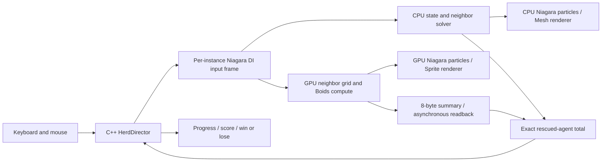

# Simulation and gameplay architecture

## Data path

`UHerdDataInterface` integrates simulation through Niagara's per-instance lifetime
and scheduling. It is custom Niagara code, rather than a stock-module-only Boids
graph. Both Niagara assets contain editable spawn/update stacks and dynamic inputs
for position, velocity and color. The CPU emitter is CPUSim with a Mesh renderer;
the GPU emitter is GPUComputeSim with a Sprite renderer.

## CPU backend

`HerdSimulation.cpp` implements separation, alignment and cohesion, a perception
cone, flee/follow/graze states, leader roles, obstacle avoidance and arena bounds.
Read-only previous-frame agent data produces a separate next-state array. The
optimized search uses a 25x15 grid of linked indices, querying adjacent cells.
The baseline visits every other agent with the same rules and radius. The
automation test compares the resulting trajectories with a 0.01-unit tolerance.

Niagara can instantiate a DI both from exposed parameters and a compiled script.
Shared state is keyed by Niagara system-instance ID, and a simulation serial
prevents duplicate CPU stepping or duplicate GPU dispatch within the same tick.
Different PIE worlds and different system instances do not share simulation data.

## GPU backend

`Herd.usf` contains initialization, neighbor-grid construction and Boids update
compute kernels. The DI's render proxy enqueues them in Niagara's RDG pre-stage.
Niagara's GPU particle script samples the resulting structured agent buffer for
rendering. The render-side getter uses Niagara's native GPU execution index;
the context-map execution-index field must not be assumed initialized inside an
independently built dynamic input.

The grid stores up to 64 particle indices per cell. Each agent samples at most
eight entries in each of nine adjacent cells. This is a bounded neighbor
approximation, not an exact all-neighbor solver. Overflow counts are displayed
and recorded. Crowded cells can have a high overflow fraction and biased neighbor
coverage; the report treats this as a quality/performance trade-off. No per-agent
CPU actors are created for either configuration.

## Gameplay result integrity

An agent is rescued when its simulated position enters the goal circle. Rescue
is an absorbing state. CPU results are returned directly from the simulation;
GPU results are reduced into two uint32 values: rescued count and grid overflow.
Every sixth simulation tick, Niagara's readback manager asynchronously transfers
those eight bytes and schedules a game-thread callback. No per-frame full-state
GPU readback or blocking GPU wait is used for normal gameplay.

Each round increments a run ID. Results from a previous round or an older serial
are ignored. Mode changes and count changes create fresh rounds. Rendering keeps
rescued fish facing a valid direction while their simulation positions remain
frozen. Count-control logic stops additional bursts after the desired number of
Niagara particles exists, so later emitter loops cannot silently inflate counts.

## Performance boundaries

CPU custom solve time is measured separately from engine component Niagara
GT/worker/RT counters. GPU DI pass setup runs on the render thread, and custom
compute is inside the Niagara GPU dispatch. Use Unreal Insights GPU tracks and
the custom `HerdBoids` GPU stat along with engine component statistics. The report
must not label custom CPU solve time alone as total Niagara CPU time.

The frame-time CSV is real wall time, not the fixed-rate video clock. The benchmark
uses a repeatable moving attractor and a fixed seed. Its 4-9-second window is a
dense-follow workload. At over-budget counts, the 33.3-ms simulation step cap
changes how far the simulation advances during the wall-time window; this limits
strict trajectory equivalence between overloaded configurations. A lab-machine
rerun and a physical input playtest remain separate acceptance checks.
